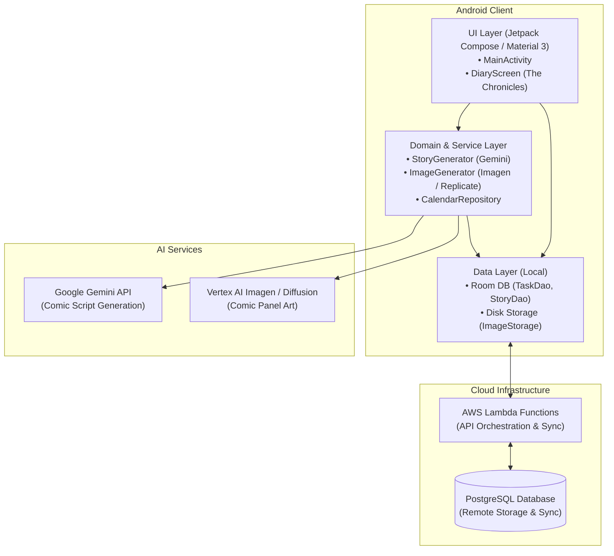

# YourStory 📖✨

> Turn your daily tasks and routines into an illustrated daily comic strip and personal chronicle.

**YourStory** is a smart productivity and journaling Android application that gamifies task management. By combining calendar events and completed daily habits, the app uses generative AI to craft a personalized 4-panel "Slice of Life" comic strip for every day—immortalizing your accomplishments, chores, and adventures in a visual diary.

---

## 🚀 What the App Does

- **Daily Task & Habit Management**: Create, categorize (`Normal`, `Chore`, `Work`, `Health`), and track daily to-dos with timestamps and swipe-to-delete actions.
- **Calendar Synchronization**: Automatically imports events and meetings from device calendars into your daily task list.
- **Generative AI Comic Scripting**: Analyzes completed tasks and highlights unique daily events, humorously exaggerating mundane chores into heroic or slice-of-life narrative beats.
- **Automated Artwork Generation**: Creates custom black-and-white manga/comic-style panels corresponding to each story beat.
- **The Chronicles (Visual Diary)**: An interactive flip-through chronicle allowing users to review past days with flexible display modes (*Mixed View*, *Comic Only*, or *Tasks Only*).

---

## 🛠️ Tech Stack

| Technology | Role | Details |
| :--- | :--- | :--- |
| **Kotlin** | Language | Modern, concise language powering the Android client with Coroutines and Kotlin Flow. |
| **Jetpack Compose** | UI Framework | Declarative UI toolkit utilizing Material 3 theming, smooth animations, and responsive pager layouts. |
| **Room** | Local Persistence | Robust SQLite abstraction layer providing offline-first local storage for tasks, story panels, and cache. |
| **AWS Lambda** | Cloud Backend | Serverless compute layer handling secure API orchestration, heavy processing pipelines, and data sync. |
| **PostgreSQL** | Relational Database | Scalable cloud database for user accounts, cross-device data synchronization, and long-term history. |
| **Google Gemini & Imagen** | Generative AI | Powers narrative script generation (`Gemini 2.5 Flash`) and panel image synthesis (`Vertex AI Imagen 3`). |

---

## 🏛️ Architecture

YourStory follows **Modern Android Architecture (Clean Architecture / MVVM)** combined with an **offline-first repository pattern** and serverless cloud backend.



### Architecture Highlights

1. **Presentation / UI Layer**: Built entirely in **Jetpack Compose**. State is hoisted reactively with Kotlin `StateFlow` and Compose runtime states, ensuring a responsive interface that adapts seamlessly to phone and tablet configurations.
2. **Domain & Services**:
   - `StoryGenerator`: Builds dynamic prompts based on task priority, sending requests to generative models to produce structured JSON comic panels.
   - `ImageGenerator`: Converts panel descriptions into stylized manga line-art through Vertex AI Imagen.
   - `CalendarRepository`: Queries Android's `CalendarContract` to seamlessly bridge schedules with daily task tracking.
3. **Data Layer & Offline First**:
   - **Local (Room & File Storage)**: Full offline capability where tasks, completed status, and generated images are immediately cached locally on device.
   - **Cloud (AWS Lambda & PostgreSQL)**: Serverless cloud backend handles authentication, multi-device backup, and synchronized story archives.

---

## 📂 Project Structure

```text
YourStory/
├── app/
│   ├── build.gradle.kts             # App dependencies & build configurations
│   └── src/main/java/com/example/yourstory/
│       ├── MainActivity.kt          # Main task list screen, actions, & comic trigger
│       ├── DiaryScreen.kt           # "The Chronicles" horizontal story reader
│       ├── Task.kt & Story.kt       # Room data entities & type converters
│       ├── TaskDao.kt & StoryDao.kt # Local SQLite database query interfaces
│       ├── AppDatabase.kt           # Room database initialization
│       ├── StoryGenerator.kt        # Gemini AI comic script orchestration
│       ├── ImageGenerator.kt        # Vertex AI / Imagen image generation client
│       ├── CalendarRepository.kt    # Android system calendar synchronization
│       ├── ImageStorage.kt          # Local image disk caching helper
│       └── ui/theme/                # Material 3 colors, typography, & themes
├── build.gradle.kts                 # Root project build configuration
└── README.md                        # Project documentation
```
